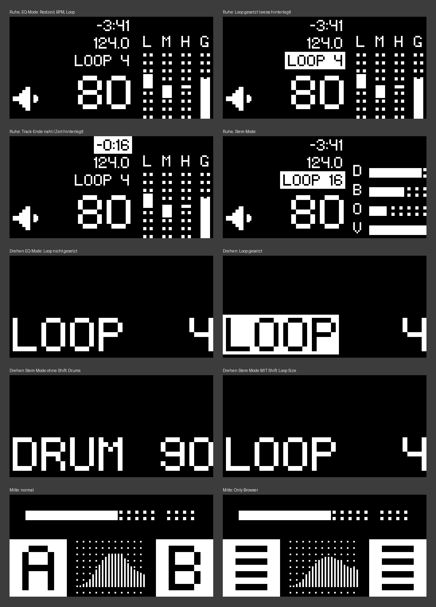

# Z1 MK2 Loop-Mod für Traktor Pro 4

Ein Mod für den **Native Instruments Traktor Kontrol Z1 MK2**. Der Gain-Knopf stellt damit die **Loop Size mit echtem Soft Takeover** ein, auf dem Z1 gibt es eine **Loop-Taste**, Tasten mit Shift-Belegung **leuchten farbig**, und die Displays zeigen zusätzlich **Restzeit, BPM und Loop**.

> Inoffizielles Community-Projekt, nicht von Native Instruments. Nutzung auf eigene Gefahr.
> Es werden **keine Dateien von Native Instruments** mitgeliefert: Der Installer ändert deine eigenen Traktor-Dateien an genau definierten Stellen und sichert vorher die Originale.

## Funktionen

**Gain-Knopf**
- EQ-Mode: Loop Size (1/32 … 32) mit Soft Takeover. Der Knopf „holt“ den Wert ab, wenn du zwischen den Modi wechselst oder die Loop Size per Maus änderst.
- Stem-Mode: Drums wie im Original. **Mit Shift: Loop Size**.

**Loop-Taste** (Shift + EQ-Taste links = Deck A, Shift + Stems-Taste rechts = Deck B)
- Kein Loop aktiv: Ein Loop mit der eingestellten Größe wird gesetzt.
- Loop aktiv: Der Loop wird beendet.
- Die Taste reagiert nur beim Drücken und kann nicht „hängen bleiben“.

**Shift-Farben** (Shift = Filter-Taste)

| Taste | Farbe | Bedeutung |
|---|---|---|
| Filter (Shift) | weiß | immer an: gedimmt = bereit, hell = gedrückt |
| Loop-Tasten | grün | hell = Loop läuft |
| FX 1 / FX 2 | blau | Sync Deck A / B, hell = Sync an ¹ |
| Stems-Taste links | weiß | Only Browser, hell = an ¹ |
| Mode | orange | Browser-Modus ¹ |
| Channel-FX-On | weiß | Sprung an den Track-Anfang ¹ |
| EQ rechts, FX 3, FX 4 | aus | haben keine Shift-Belegung |

¹ Die Funktion selbst kommt aus dem Begleit-Layout (siehe unten). Der Mod sorgt für die Farben.

**Displays**
- Seiten-Displays im Ruhezustand: Restzeit (hinterlegt kurz vor Track-Ende), BPM und Loop Size (hinterlegt, wenn ein Loop gesetzt ist).
- Beim Drehen am Gain-Knopf: „LOOP“ + Größe. Passt der Soft-Takeover-Pfeil nicht neben den Wert, steht er darüber.
- Mittleres Display: Im „Only Browser“-Modus erscheinen Listen-Symbole statt A und B, der Effekt bleibt sichtbar.

## Voraussetzungen

- Windows, Traktor Pro 4 (entwickelt und getestet mit **4.5.1**), Traktor Kontrol Z1 MK2.
- Andere Traktor-Versionen funktionieren, solange Native Instruments die betroffenen Stellen nicht geändert hat. Der Installer prüft das und bricht sonst ab, ohne etwas zu verändern.

## Installation

1. Repository als ZIP herunterladen und entpacken.
2. Traktor beenden.
3. Doppelklick auf **`Installieren.bat`**. Windows fragt einmal nach Administratorrechten, weil Traktor unter „Programme“ liegt.
4. Traktor starten.

### Begleit-Layout (empfohlen)

[`layout/Z1MK2 Layout fuer Loop-Mod.tsi`](layout/) ist das Controller-Layout des Autors: Shift auf der Filter-Taste, Sync, Seek, Browser-Steuerung und mehr. Belegung: [`layout/LAYOUT.md`](layout/LAYOUT.md).

Import: Traktor → Preferences → Controller Manager → „Add…“ → „Import TSI“. Ein vorhandener Z1-MK2-Eintrag sollte vorher entfernt werden.

**Eigenes Layout?** Damit der Mod deine Shift-Taste erkennt, muss im Controller Manager bei der Zeile, die die Filter-Taste zu Shift macht, **„Override factory map“ aus** sein. Dasselbe gilt für alle Zeilen, die nur mit Shift aktiv sind und deren Taste leuchten soll.

## Probleme?

**Loop-Taste setzt immer 4 Beats:** In Version 6 und älter ein Fehler im Mod, behoben in Version 7. Einfach den Installer erneut ausführen.

**Shift-Funktionen spinnen oder Aktionen passieren doppelt:** Doppelklick auf **`Layout pruefen.bat`** zeigt alle Z1-MK2-Einträge im Controller Manager. Das Skript liest nur und ändert nichts. Einträge mit Port „None“ sind inaktiv und schaden nicht. Stören können nur mehrere Einträge **mit** zugewiesenem Gerät, oder ein Layout mit alten Loop-Zeilen. Entfernen: Controller Manager → Eintrag bei „Device“ wählen → „Edit…“ → „Remove“.

**Controller wird nach der Installation nicht erkannt:** `Deinstallieren.bat` ausführen und ein Issue mit der Traktor-Version aufmachen.

## Deinstallation

Doppelklick auf **`Deinstallieren.bat`**. Die gesicherten Originale kommen zurück (Sicherung unter `C:\ProgramData\Z1MK2-Loop-Mod\backup`).

## Nach einem Traktor-Update

Ein Update ersetzt Traktors Dateien, der Mod ist danach weg. Einstellungen, Collection und Controller-Layout bleiben erhalten. Einfach **`Installieren.bat` erneut ausführen**:
- Passen die Stellen noch, ist der Mod sofort wieder da.
- Hat Native Instruments etwas geändert, bricht der Installer ab und ändert nichts. Dann muss `patches/patches.json` angepasst werden, siehe [`dev/README.md`](dev/README.md).

Bis dahin läuft der Z1 im Original. Wer das Begleit-Layout nutzt, importiert für diese Zeit besser sein altes Layout. Sonst wählt die Filter-Taste beim Shift-Drücken zusätzlich den Filter-Effekt.

## Wie es funktioniert

Traktor steuert den Z1 MK2 über QML-Dateien in `Resources64\qml\CSI\Z1MK2` und `…\Screens\Z1MK2`. `patches/patches.json` beschreibt jede Änderung als „suche genau diesen Text, ersetze ihn durch jenen“. Der Installer:
1. liest deine Originaldateien und sichert sie,
2. wendet alle Änderungen im Speicher an und bricht ab, wenn eine Stelle nicht genau einmal vorkommt,
3. schreibt erst dann die Dateien und prüft sie.

Alle Änderungen sind in den Dateien mit `MOD` kommentiert.

---

## English summary

Unofficial mod for the **Traktor Kontrol Z1 MK2** (Traktor Pro 4, built and tested on 4.5.1, Windows):
- In EQ mode the gain knob controls **loop size with proper soft takeover**. In stem mode it controls drums, and with Shift it controls loop size.
- A **loop button**: Shift + EQ button (left) / Shift + Stems button (right). It sets a loop if none is active and exits an active loop.
- **Shift colours**: buttons with a Shift function light up in context colours while Shift (Filter button) is held.
- Displays show **remaining time, BPM and loop size**, highlight set loops and the track-end warning, and show a browser icon in Only-Browser mode.

No Native Instruments files are distributed. `Installieren.bat` patches your own installation at well-defined spots (backup in `C:\ProgramData\Z1MK2-Loop-Mod\backup`). `Deinstallieren.bat` restores the originals. After a Traktor update, run the installer again. It refuses to change anything if the patch spots differ.

*Native Instruments, Traktor and Kontrol are trademarks of Native Instruments GmbH. This project is not affiliated with Native Instruments.*
